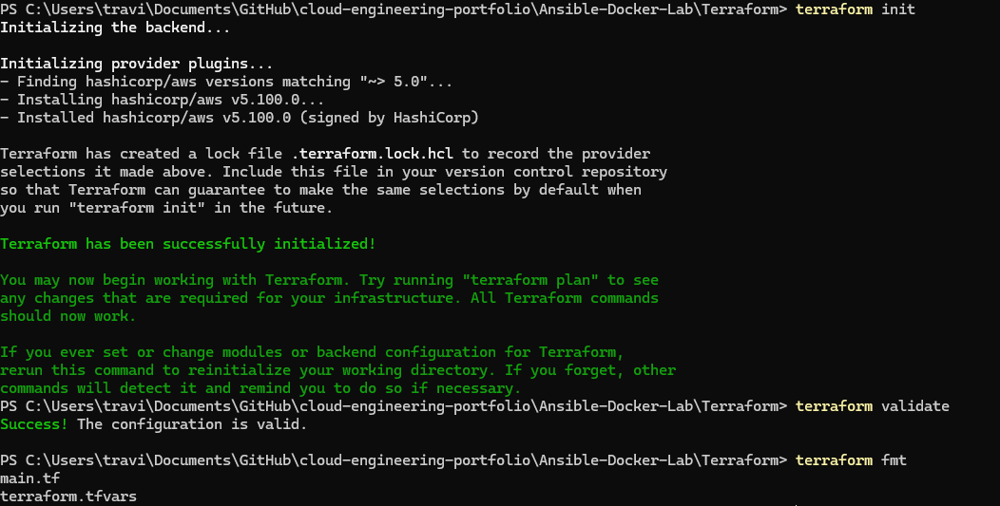
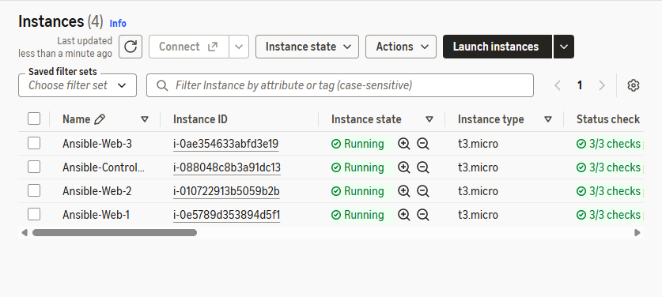
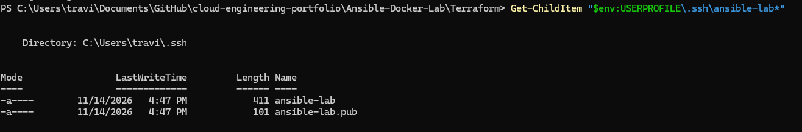
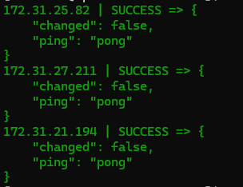
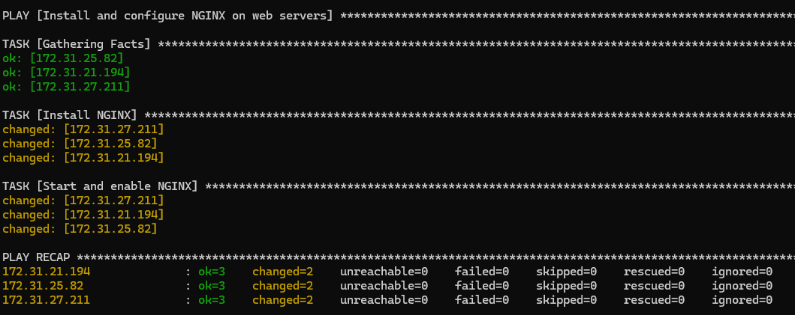
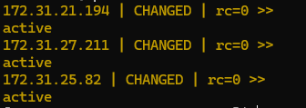
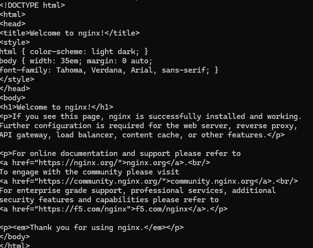
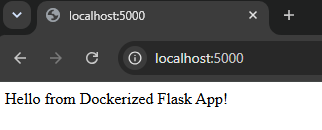
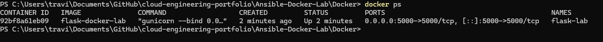
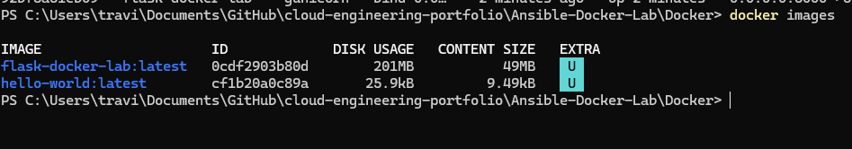

# Ansible, Terraform & Docker Cloud Engineering Lab

## Project Overview

This project demonstrates practical cloud engineering, Infrastructure as Code (IaC), configuration management, Linux administration, and containerization using AWS, Terraform, Ansible, and Docker.

The lab was completed in two parts:

1. **Infrastructure Provisioning & Configuration Management:** Provisioned AWS EC2 infrastructure using Terraform and automated the configuration of three Linux web servers using Ansible.
2. **Application Containerization:** Built and deployed a Python Flask web application inside a Docker container.

All AWS resources created for this lab were successfully destroyed after testing to avoid ongoing cloud infrastructure costs.

---

## Technologies Used

| Technology | Purpose |
|---|---|
| AWS EC2 | Cloud-hosted Linux infrastructure |
| Terraform | Infrastructure as Code |
| Ansible | Configuration management and automation |
| Amazon Linux 2023 | Linux server operating system |
| NGINX | Web server deployment |
| Docker | Application containerization |
| Python | Application development |
| Flask | Python web framework |
| Gunicorn | Python WSGI application server |
| Git & GitHub | Version control and project documentation |

---

# Part 1: Infrastructure Provisioning & Configuration Management

## Terraform – AWS Infrastructure

Terraform was used to provision the following AWS resources:

- One Ansible control server
- Three Amazon Linux 2023 web servers
- AWS security groups
- AWS key pair configuration

Security groups were configured to restrict SSH access to the appropriate sources and allow HTTP traffic to the web servers.

### Terraform Validation



### AWS EC2 Infrastructure

The four EC2 instances were successfully provisioned in AWS.



## Ansible – Configuration Management

Ansible was installed on the control server and configured to manage the three web servers using their private IP addresses.

SSH key-based authentication was configured to allow secure communication between the Ansible control server and the managed nodes.

### SSH Key Configuration



### Ansible Connectivity Testing

Ansible connectivity was verified across all three web servers using the Ansible ping module.



### Automated NGINX Deployment

An Ansible playbook was created to:

- Install NGINX on all three web servers
- Start the NGINX service
- Enable NGINX to start automatically at boot

The playbook executed successfully across all managed nodes.



### NGINX Service Verification

The NGINX service was verified as active on all three web servers.



The NGINX welcome page was also successfully accessed over HTTP.



---

# Part 2: Docker – Containerized Flask Application

## Application Development

A lightweight Python Flask application was created to demonstrate application containerization.

The application returns a simple message when accessed through its root endpoint:

`Hello from Dockerized Flask App!`

## Docker Image Creation

A Dockerfile was created using the official Python 3.12 slim image.

The image configuration:

- Sets the working directory
- Installs application dependencies
- Copies the Flask application into the image
- Exposes port 5000
- Uses Gunicorn to serve the application

The Docker image was successfully built locally.

### Dockerized Flask Application



### Running Docker Container

The Flask application was deployed inside a running Docker container with port 5000 mapped to the local machine.



### Docker Image Verification

The completed Docker image was verified locally.



---

## Project Structure

```text
Ansible-Docker-Lab/
│
├── Ansible/
│   ├── inventory.ini
│   └── playbook.yml
│
├── Docker/
│   ├── app.py
│   ├── Dockerfile
│   └── requirements.txt
│
├── Screenshots/
│   ├── 01-terraform-validation.png
│   ├── 01-ec2-instances.png
│   ├── 02-ansible-version.png
│   ├── 02-ssh-key-generation.png
│   ├── 03-ansible-connectivity.png
│   ├── 04-ansible-playbook.png
│   ├── 05-nginx-status.png
│   ├── 06-nginx-browser-test.png
│   ├── 07-docker-flask-browser.png
│   ├── 08-docker-container-status.png
│   └── 09-docker-image.png
│
└── Terraform/
    ├── main.tf
    ├── variables.tf
    ├── outputs.tf
    ├── terraform.tfvars.example
    └── .terraform.lock.hcl
```

---

## Skills Demonstrated

- AWS EC2 provisioning and cloud infrastructure management
- Infrastructure as Code using Terraform
- Terraform validation, planning, applying, and destroying infrastructure
- Linux server administration
- SSH key generation and key-based authentication
- Ansible inventory management and configuration automation
- Ansible playbook development and execution
- NGINX installation and service management
- Python application development
- Dockerfile creation and image building
- Docker container deployment and management
- Git version control and GitHub project documentation

## Project Outcome

Successfully completed an end-to-end cloud engineering lab covering infrastructure provisioning, configuration management, and application containerization.

The project provided hands-on experience connecting multiple technologies into a practical deployment workflow, from provisioning cloud infrastructure to automating server configuration and deploying a containerized application.

All seven Terraform-managed AWS resources were successfully destroyed after testing. The project source code, documentation, and screenshots remain available in this repository.