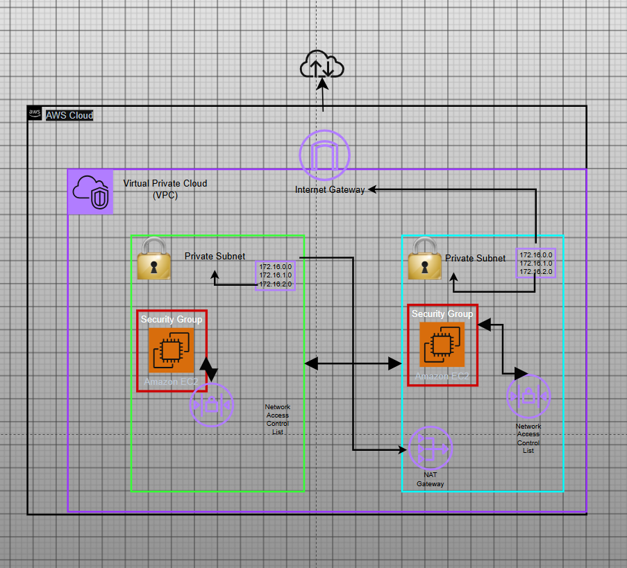

# Linux, Bash & AWS EC2 Fundamentals

## Project Overview

This project documents my hands-on learning of Linux administration, Bash scripting, and Amazon Web Services (AWS).

The goal of this lab is to gain practical experience deploying and managing a Linux-based cloud server using AWS EC2 while developing foundational Linux command-line skills.

## Objectives

- Create and configure an AWS Security Group.
- Deploy an Ubuntu Linux EC2 instance.
- Connect to a cloud-based Linux server.
- Build and manage Linux directory structures.
- Understand Linux file permissions.
- Create and execute Bash scripts.
- Archive and compress files using TAR and GZIP.
- Document cloud infrastructure and technical tasks using GitHub.

## Technologies Used

| Technology | Purpose |
|---|---|
| AWS EC2 | Cloud-based virtual server |
| Ubuntu Linux | Server operating system |
| Bash | Command-line scripting |
| GitHub | Project documentation and version control |
| Nano | Linux text editor |
| TAR / GZIP | File archiving and compression |

## Project Architecture

The lab includes a VPC architecture design containing public and private subnets, routing, an Internet Gateway, and a NAT Gateway.

### VPC Architecture Diagram

## Implementation

The following tasks will be completed and documented:

1. AWS Security Group configuration.
2. Ubuntu EC2 instance deployment.
3. Linux server access and configuration.
4. Directory and file creation.
5. Linux file permission management.
6. Bash scripting and execution.
7. File archiving and compression.
8. README documentation using Nano.

## Screenshots

Screenshots documenting each implementation step will be stored in the `Screenshots/` directory.

## Challenges

Challenges encountered during deployment, configuration, and troubleshooting will be documented here.

## What I Learned

This project is designed to develop practical experience with AWS infrastructure, Linux administration, Bash scripting, and cloud-based server management.

## Real-World Applications

These skills are foundational to cloud engineering, systems administration, infrastructure management, and automation.

## Outcome

Hands-on experience deploying an Ubuntu EC2 instance, managing Linux files and permissions, executing Bash scripts, and documenting cloud infrastructure.
