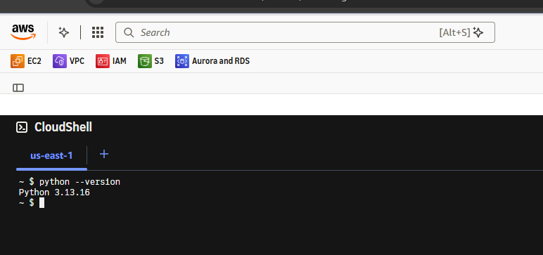
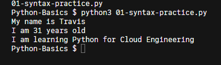
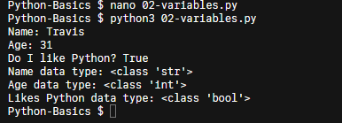
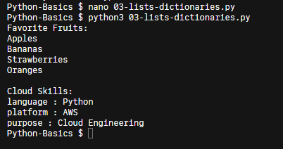
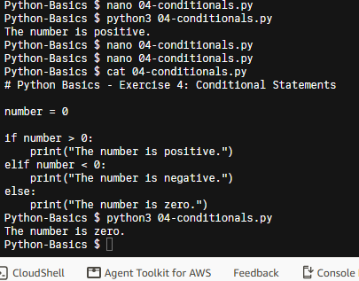
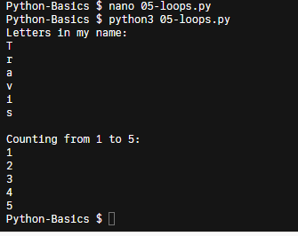
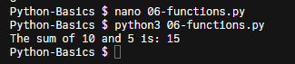
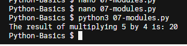

# Python Fundamentals

## Overview

This project demonstrates foundational Python programming concepts through hands-on exercises executed in AWS CloudShell using Python 3.13.16.

The exercises cover core programming concepts, including variables, data structures, conditional logic, loops, functions, and importing custom modules.

## Technologies Used

- Python 3.13.16
- AWS CloudShell
- Linux Command Line
- GitHub

## Project Structure

```text
Python-Basics/
├── README.md
├── 01-syntax-practice.py
├── 02-variables.py
├── 03-lists-dictionaries.py
├── 04-conditionals.py
├── 05-loops.py
├── 06-functions.py
├── 07-modules.py
├── math_module.py
└── screenshots/
```

## Exercises

### 1. Python Syntax
- Used print statements to display text.
- Executed a basic Python program.

### 2. Variables and Data Types
- Created variables using strings, integers, and booleans.
- Used Python's type() function to identify data types.

### 3. Lists and Dictionaries
- Created and accessed lists.
- Created dictionaries using key-value pairs.
- Used loops to display stored information.

### 4. Conditional Statements
- Implemented if, elif, and else statements.
- Tested positive, negative, and zero values.

### 5. Loops
- Used for loops to iterate through characters in a string.
- Used while loops to count from 1 to 5.

### 6. Functions
- Defined a reusable function.
- Passed two numbers into a function.
- Returned the calculated sum.

### 7. Python Modules
- Created a custom Python module.
- Imported the module into a separate Python script.
- Called a function from the imported module.

## Screenshots

### Python Environment


### Syntax Practice


### Variables and Data Types


### Lists and Dictionaries


### Conditional Statements


### Loops


### Functions


### Modules


## Execution

Each Python script can be executed using:

```bash
python3 filename.py
```

Example:

```bash
python3 07-modules.py
```

## Skills Demonstrated

- Python fundamentals
- Variables and data types
- Lists and dictionaries
- Conditional logic
- Iteration and loops
- Function creation and reuse
- Module imports
- Linux command-line execution
- Technical documentation

