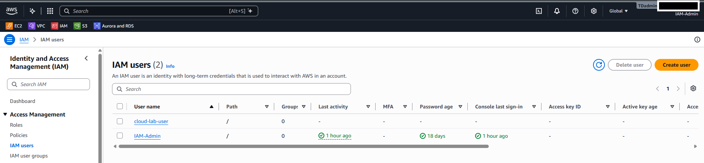
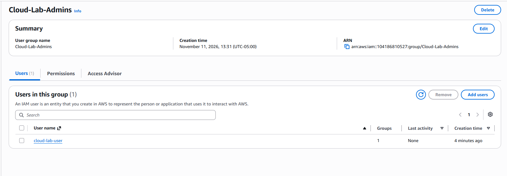
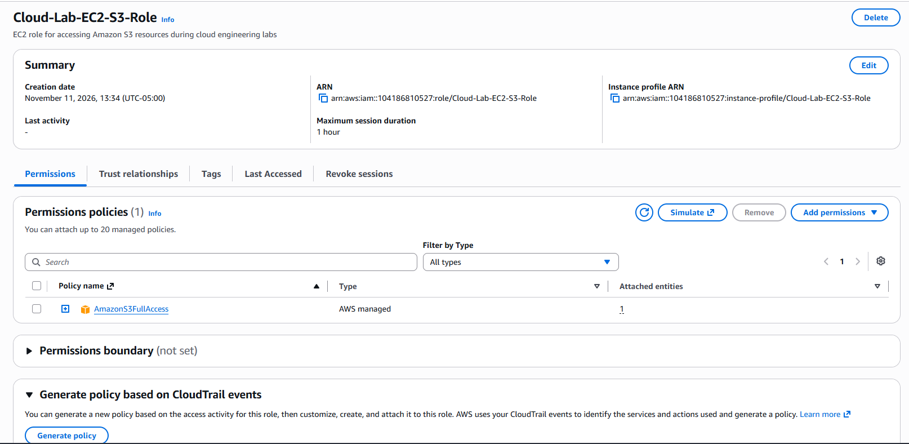
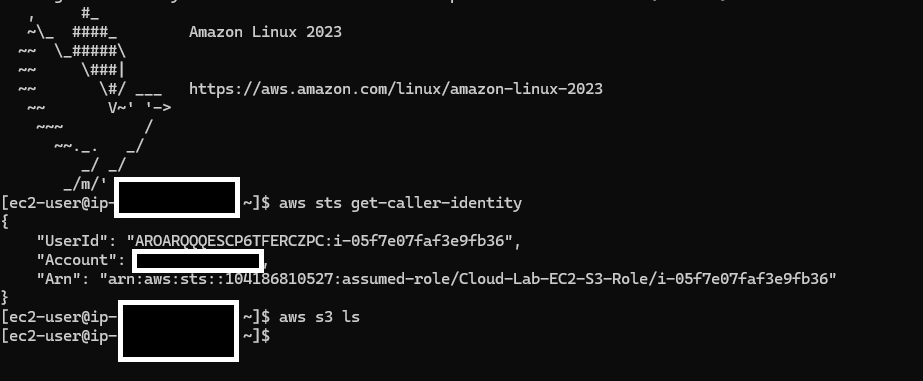
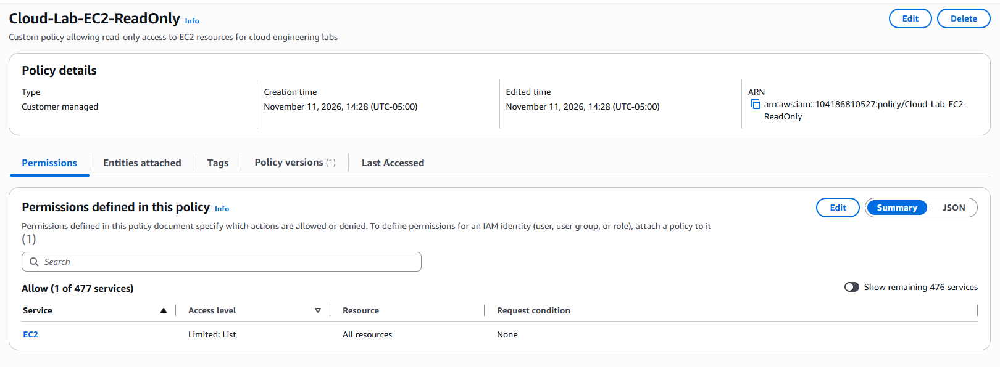
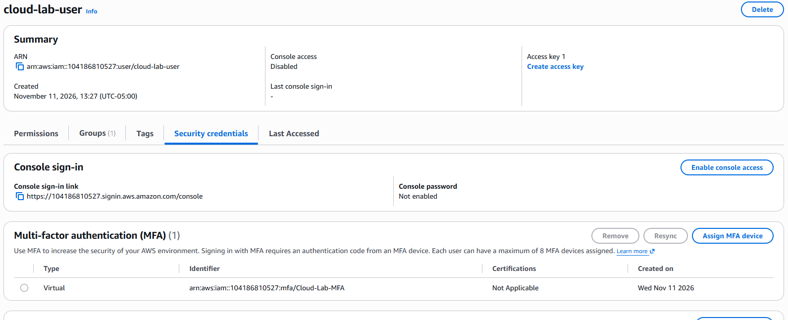

# Week 3 – AWS IAM Lab

## Overview

This lab focused on AWS Identity and Access Management (IAM), including creating IAM users, groups, roles, custom policies, and enabling multi-factor authentication (MFA).

The goal was to understand how AWS manages access to resources and how permissions can be assigned using the principle of least privilege.

## 1. IAM User Creation

Created an IAM user named `cloud-lab-user` and attached the AWS-managed `AmazonS3ReadOnlyAccess` policy.

This policy allows the user to view S3 resources without modifying or deleting them.



## 2. IAM Group Creation

Created an IAM group named `Cloud-Lab-Admins` and attached the `AmazonS3ReadOnlyAccess` policy.

Added `cloud-lab-user` to the group to demonstrate how permissions can be managed centrally through group membership.



## 3. IAM Role Creation

Created an IAM role named `Cloud-Lab-EC2-S3-Role`.

- Trusted entity: AWS service (EC2)
- Attached policy: `AmazonS3FullAccess`

The role allows an EC2 instance to access S3 resources without storing permanent AWS credentials on the instance.



## 4. EC2 IAM Role Testing

Launched a temporary Amazon Linux 2023 EC2 instance and attached the IAM role.

Connected to the instance through SSH and ran the following commands:

```bash
aws sts get-caller-identity
aws s3 ls
```

The `get-caller-identity` command confirmed that the EC2 instance successfully assumed the `Cloud-Lab-EC2-S3-Role`.

The `aws s3 ls` command executed successfully, returning an empty response because no S3 buckets were present.

The EC2 instance was terminated after testing to avoid ongoing compute charges.



## 5. Custom IAM Policy

Created a customer-managed IAM policy named `Cloud-Lab-EC2-ReadOnly`.

The policy grants permission to describe EC2 resources without allowing modifications or deletions.

Policy permissions:

- Effect: Allow
- Action: `ec2:Describe*`
- Resource: `*`

The JSON policy is included in the [Policies folder](Policies/Cloud-Lab-EC2-ReadOnly.json).



## 6. Multi-Factor Authentication (MFA)

Enabled MFA for the IAM user `cloud-lab-user` using an authenticator app.

This adds an additional layer of security by requiring a time-based verification code during authentication.



## Key Concepts Learned

- IAM users represent individual identities in AWS.
- IAM groups simplify permission management across multiple users.
- IAM roles provide temporary credentials to trusted services such as EC2.
- IAM policies define what actions identities and resources are allowed to perform.
- Custom policies allow permissions to be tailored to specific requirements.
- MFA adds another layer of protection to AWS accounts.
- The principle of least privilege helps reduce unnecessary access.

## Lab Cleanup

After completing the lab, the temporary EC2 instance was terminated. The RDS database from the SQL lab was also deleted.

IAM users, groups, roles, and policies were retained for documentation and learning purposes.

## Skills Demonstrated

- AWS IAM administration
- User and group management
- IAM role creation and EC2 integration
- AWS managed and custom IAM policies
- MFA configuration
- EC2 Linux administration
- SSH connectivity
- AWS CLI
- IAM permission verification
