# Terraform Infrastructure as Code – AWS EC2 & S3

## Project Overview

This project demonstrates hands-on experience using **Terraform** to provision, manage, secure, and destroy AWS infrastructure through Infrastructure as Code (IaC).

The goal was to learn how to automate AWS resource management using Terraform and the AWS CLI rather than relying entirely on manual configuration through the AWS Management Console.

## Technologies Used

- Terraform
- Amazon Web Services (AWS)
- AWS EC2
- AWS S3
- AWS IAM
- AWS CLI
- HashiCorp Configuration Language (HCL)
- Visual Studio Code
- Git & GitHub

## Infrastructure Implemented

### 1. EC2 Instance Management

- Configured the Terraform AWS provider.
- Retrieved the latest Amazon Linux 2023 AMI through AWS Systems Manager Parameter Store.
- Provisioned an EC2 instance using Terraform.
- Modified the instance type and reviewed infrastructure changes.
- Used `terraform plan` to preview changes before applying them.
- Destroyed the EC2 instance through Terraform.

### 2. S3 Bucket Provisioning & Security

- Created an S3 bucket using Terraform.
- Configured all four S3 Block Public Access settings.
- Enabled default server-side encryption using AES-256 (SSE-S3).
- Verified encryption and public access settings through the AWS Console.

## Terraform Commands Practiced

| Command | Purpose |
|---|---|
| `terraform init` | Initialize the working directory |
| `terraform fmt` | Format Terraform configuration |
| `terraform validate` | Validate configuration |
| `terraform plan` | Preview infrastructure changes |
| `terraform apply` | Create or update resources |
| `terraform destroy` | Remove managed infrastructure |

## Project Structure

```text
Terraform-IaC/
├── Screenshots/
├── .gitignore
├── .terraform.lock.hcl
├── main.tf
└── README.md
```


### Environment Setup
## Screenshots

### Environment Setup

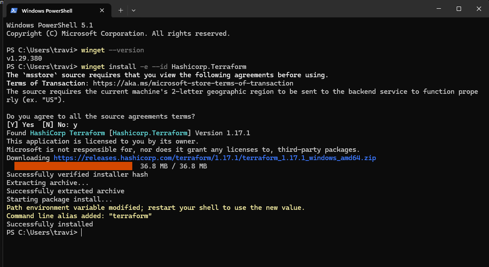

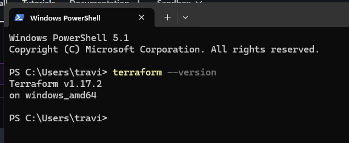

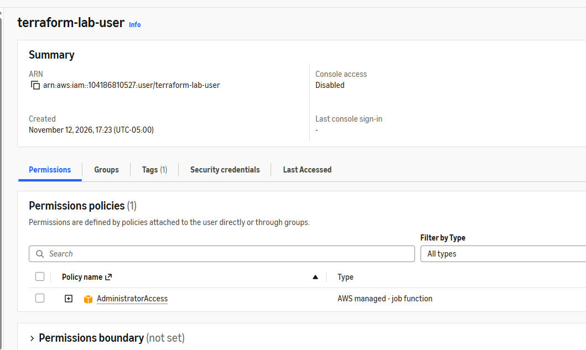

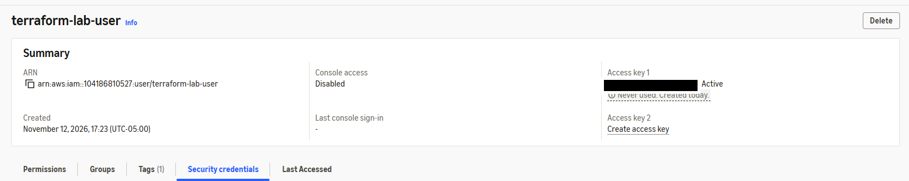

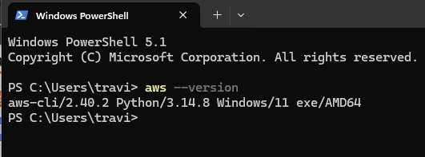

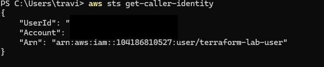

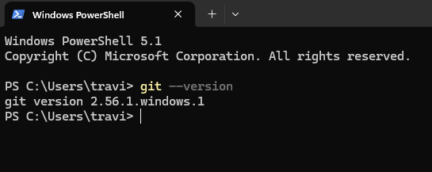

### Terraform EC2 Deployment

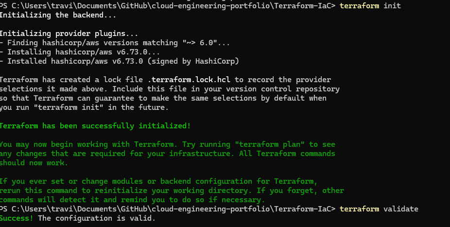

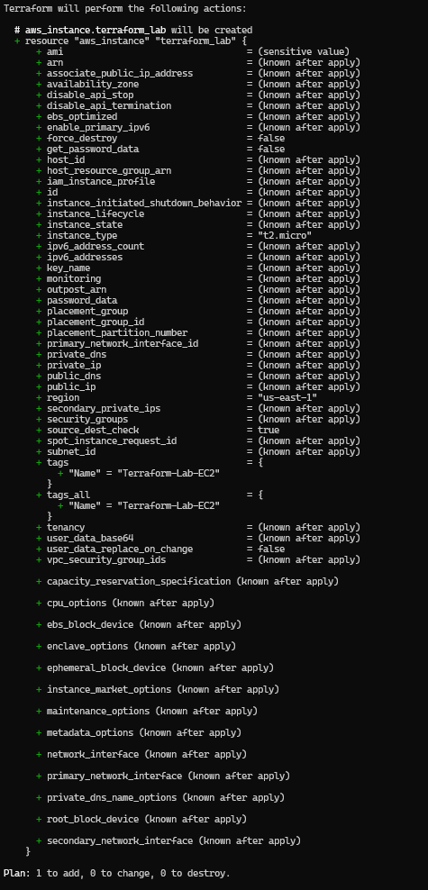

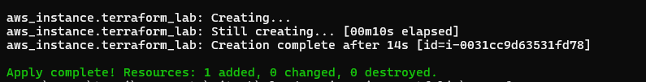

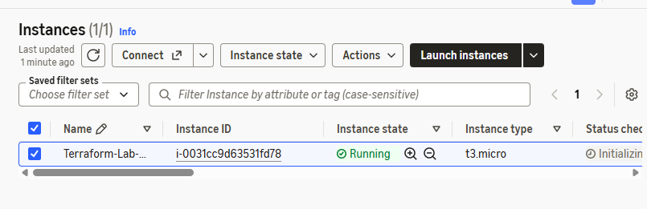

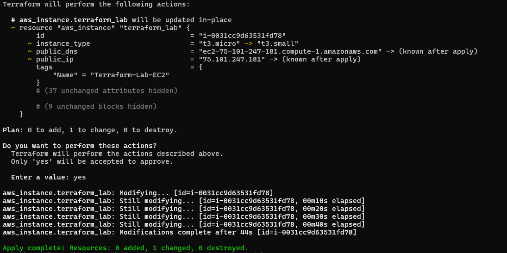

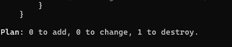

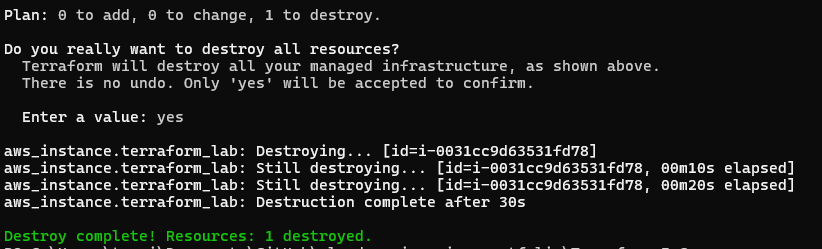

### S3 Provisioning and Security

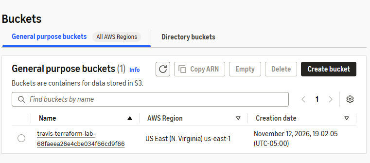

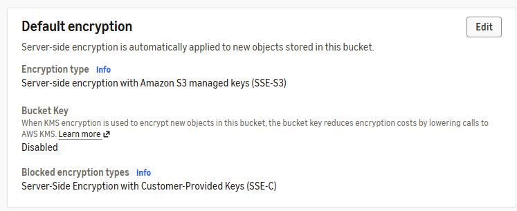

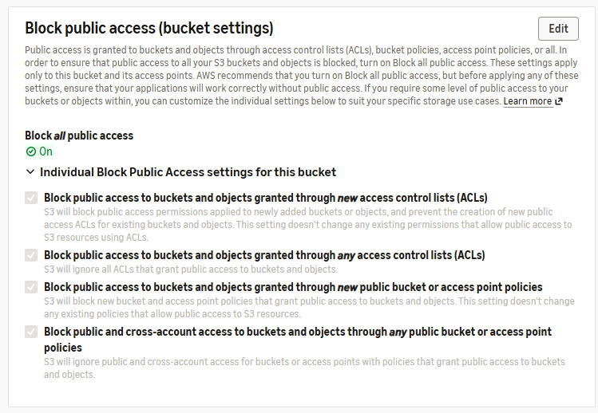

## Key Takeaways

- Provisioning AWS infrastructure using Terraform.
- Managing infrastructure through declarative HCL configuration.
- Understanding Terraform state and resource lifecycle management.
- Using Terraform plans to review changes before deployment.
- Applying AWS S3 security best practices.
- Integrating Terraform workflows with AWS IAM and the AWS CLI.

## Cleanup

AWS resources created during the lab were managed and destroyed through Terraform when no longer required.

All AWS resources created during this lab, including the S3 bucket and its security configurations, were destroyed through Terraform to prevent unnecessary ongoing charges.

---

**Project Type:** Hands-on Cloud Engineering / Infrastructure as Code
